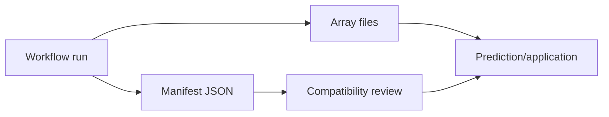

# Model Artifacts

!!! abstract "Summary"
    How trained models are saved, versioned, reviewed, and reapplied — the bridge from a good run to a reusable calibration.

Model artifacts persist trained models. They are the bridge between "this workflow run looked good" and "this calibration or classifier can be reviewed, versioned, reapplied, or handed to another system."

## What a Model Artifact Is

For a PLS calibration, the artifact should answer practical questions such as:

- What dataset and target was used?
- What preprocessing and parameters were applied?
- What spectral axis and feature count does the model expect?
- Which fitted arrays are needed to predict new spectra?
- What validation metrics justified saving it?
- Which run, user, project, and timestamp produced it?

## Stored Form

SpectraSherpa stores model artifacts as **readable metadata plus numeric state**.

The readable part is a manifest. The schematic below illustrates the kinds of
context it records; it is not the actual serializer schema or a valid artifact
to construct by hand:

```json
{
  "artifact_type": "pls_regression",
  "created_from_run": "run_2026_06_05_001",
  "target": {"name": "moisture", "units": "%"},
  "spectral_axis": {"units": "cm^-1", "n_features": 1557},
  "preprocessing": ["snv", "savgol_derivative"],
  "metrics": {"rmsep": 0.18, "r2": 0.94, "bias": -0.02},
  "arrays": ["x_mean.npy", "x_scale.npy", "coef.npy", "loadings.npy"]
}
```

The numeric state files hold values that should not be hand-edited: regression coefficients, loadings, scaling vectors, class centers, or other fitted arrays. Keeping this fitted state alongside a readable manifest makes the artifact both reviewable by humans and precise enough for later application.



## Why They Matter

A calibration or classifier is useful only if it can be reapplied to compatible spectra. The artifact should carry enough contract information to explain what the model expects, why it was saved, and what has to match at apply time.

## Publication custody

Application-owned model files have a private ownership claim before publication.
That claim is not a saved model or evidence of a successful run. It remains if
execution fails or times out, and transfers to the completed model record in the
same database transaction that registers the artifact. Startup cleanup must not
discard a claimed file merely because it is old.

Detailed View's Run Trial results are temporary (the Inspector's Run Node can
retain a run and model). After temporary execution and file writers
have stopped, the owner records terminal cleanup intent, removes the temporary
model directory, and retains a compact revocation receipt. Interrupted cleanup
is retried at startup and every minute. Retained models and overlapping live
storage references prevent deletion. A failed claim grants no cleanup authority.

New publications have an execution-attempt identity and a five-minute lease,
renewed every thirty seconds while their owning execution task is alive. Expiry
permits **revocation**, not a claim that a transaction aborted. Recovery first
commits a database fence under the same owner lock used by model registration.
A held registration COMMIT must finish before this fence can be established.
Registration requires the matching execution receipt; a fenced or missing
owned claim refuses late registration before any persistence side effects.

Filesystem writes and cleanup also share one cross-process identity lock.
Cleanup durably records a separate storage fence before removing canonical
files and attributable `.staging-<uid>-…` scratch. This protects against a
writer thread surviving loss of its database connection. Interrupted cleanup
retries; the fence is not a claim that deletion finished. Imports allocate a new
identity rather than reusing a reserved identity. Referenced paths and recovery
backups remain protected. Never delete lock files or revocation markers manually.

**Known retention limit:** each reclaimed identity leaves its lock/fence files,
including after normal temporary-trial cleanup and account erasure. These small
files currently accumulate in one directory. Bounded fence compaction is a
follow-up; a missing database tombstone alone cannot authorize removal because
a disconnected or paused writer may still hold that identity. A safe compactor
must prove all writers for a retired ownership epoch are stopped and preserve
the same protection across recovery snapshots. Until that protocol is qualified,
retain the markers and include their inode usage in storage capacity monitoring.

Hosted account-erasure plans also retain publication identities. Completion
joins any surviving file writer and fences its identity before reporting the
workspace erased; losing a database connection does not prove a writer stopped.
A failed filesystem durability barrier leaves recovery pending with its files
protected. Automatic crash reclamation is not yet qualified on Windows, whose
directory-durability primitive differs. Background recovery retains those files
and logs an operator recovery warning. Normal trial cleanup remains available:
the original execution closes further publication, joins all its file writers,
and removes only its own unreferenced files under the shared identity lock.
Its database revocation record remains, without a durable-reclamation timestamp.
Background recovery never infers this stopped-execution authority from a flag
or elapsed time. A failed explicit cleanup can be retried by that same stopped
execution; after process loss, offline reconciliation is required on Windows.

Historical claims without execution ownership remain protected: their age and
absent model rows cannot prove that deleting them is safe. Account erasure or
an explicitly reviewed offline reconciliation is required for those claims.

### Ownership migration and recovery qualification

Migration `r7s9t1u3v105` adds nullable ownership fields without assigning invented
owners to historical claims. Stop **all** old application and cleanup processes
before upgrading; mixed old/new workers are unsupported because old cleanup
does not preserve revocation receipts. Downgrade refuses while owned claims or
tombstones exist. Do not delete those rows to force a downgrade.

All writers and cleanup processes must mount the same model data root **and**
its sibling `.model-publication-locks` directory, using a filesystem with reliable
cross-process locking. Back up and restore the database, model storage, and
lock/fence directory as one consistent snapshot. A local concurrency test is
not qualification of a different network filesystem or a production restore.

`tests/test_publication_lease.py` covers admission, renewal, fencing, retry and
legacy preservation. `tests/test_publication_platforms.py` exercises the
unsupported-platform policy on every runner: preserve crash-left files, join
cancelled writers, refuse foreign attempts and retain overlapping custody.
`tests/test_publication_postgres.py` uses separate real
processes and disposable databases: held COMMIT (commit and abort), terminated
database connection with a surviving filesystem writer, and hard-killed writer
scratch. Run with `PUBLICATION_TEST_POSTGRES_URL` pointing at a disposable
PostgreSQL cluster and `REQUIRE_PUBLICATION_POSTGRES=1`; the Ubuntu PostgreSQL
CI lane requires these tests rather than treating skipped tests as evidence.

Publication rechecks the live owner under a short database lock; fitting does
not hold that lock. Cancellation waits for the actual file writer to stop before
releasing custody. File publication uses separate bounded thread capacity from
computation to avoid deadlock under concurrent runs. An uncertain claim commit
does not authorize writing files.

SDK callers that supply their own storage capability remain responsible for its
ownership and cleanup. These safeguards do not retroactively identify historical
orphan files or certify deletion of backups.

## Apply-Time Review

Before applying a model, confirm spectral axis, preprocessing, feature count, and units match the training data.

Training exclusions select the fitted cohort; they are not replayed as row
exclusions on new observations. Applying a curated PCA or PLS artifact processes
the new dataset's eligible rows, not the training dataset's row positions.

For example, a PLS model trained on absorbance spectra from 4000-650 cm^-1 should not be applied blindly to transmittance spectra, truncated axes, different resolution, or spectra preprocessed outside the saved workflow contract.
