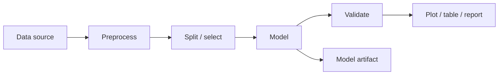

# Workflow Execution

!!! abstract "Summary"
    How workflows execute: the graph model, node contracts, and what happens when you press Run. For SDK users and developers.

SpectraSherpa workflows are directed graphs.

## Execution Flow

1. Data nodes load or materialize datasets.
2. Transform nodes preprocess or select variables.
3. Model nodes fit or apply estimators.
4. Validation nodes compute metrics.
5. Output nodes render plots, tables, summaries, and exports.

## Scientific worker lifetime

The default executor offloads eligible scientific nodes into a disposable
process owned by one workflow execution. Sequential nodes reuse that process's
scientific-library bootstrap; another workflow never inherits its state.
Each node gets a new node instance, runtime binding, capability check and event
loop. Unseeded random streams are reset between dispatches; explicit node seeds
remain authoritative. This is process-lifetime isolation, not a sandbox for
arbitrary third-party Python code.

The worker is reaped on scope exit, cancellation, timeout or dispatch failure.
Queueing, startup and transport count against the dispatch timeout. A closed
scope cannot start a previously queued request. The operating-system parent
sentinel also ends the worker if the backend exits abruptly. Standalone calls
outside a workflow retain one process per call.

Nested execution after a completed node discards the idle outer worker before
acquiring capacity; the outer workflow starts a fresh worker if it resumes.
Nesting during an active dispatch is refused instead of cancelling that node
or deadlocking. Linux retains its clean preloaded forkserver; macOS and Windows
use spawn. No workflow state is placed in the forkserver.

`tests/test_executor_pool.py` covers isolation, capability refusal, parent death,
capacity recovery, cancellation, nested execution and numerical parity. Worker
diagnostics separate actual node execution from total dispatch time; the first
dispatch includes bootstrap. Scientific calculations and persisted outputs are
unchanged by this execution-lifetime policy.

## Port Semantics

Nodes declare input and output ports. Good workflow behavior depends on these declarations matching scientific meaning, not only runtime Python shapes.

For example, a PLS node's `X` input expects spectra or feature data, while its `y` input expects target values. Both may be arrays at runtime, but they are not scientifically interchangeable. Port contracts are what let the UI reject dangerous wiring before a user trains a model on the wrong thing.

## Reproducibility

Workflow runs capture parameters and outputs so results can be revisited. Model artifacts store fitted model state separately from the interactive run.

Useful run records include:

- input dataset identifiers and source file names
- node versions and parameters
- preprocessing steps in order
- validation split or cross-validation design
- primary plots, tables, and metrics
- model artifact identifiers

This is how SpectraSherpa turns a visual workflow into a reviewable scientific record.
