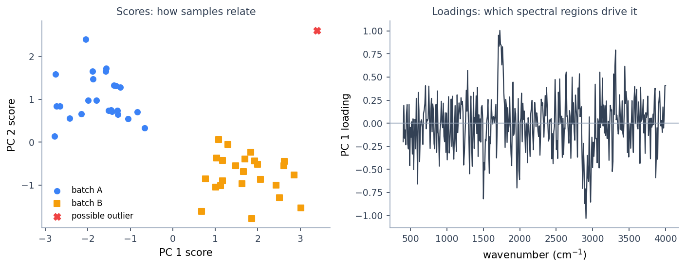

# PCA and Exploratory Analysis

!!! abstract "Summary"
    How to read a PCA model: scores, loadings, explained variance, Hotelling
    T² and Q residuals, how many components to keep, and when to move on to PLS
    or classification.

Principal Component Analysis summarizes variation in a spectral matrix through a smaller set of components. It needs no response values and is useful for exploring sample structure, preprocessing effects, and unusual observations. Exploratory PCA does not establish predictive performance; component selection and outlier decisions still need a design appropriate to the scientific question.

## Use PCA For

- checking sample clustering
- spotting outliers
- assessing preprocessing
- inspecting loadings
- finding instrument or batch drift
- deciding whether calibration or classification is plausible

## When PCA Is Not Enough

- You have a quantitative target and need a number: use [PLS](pls.md). PCA ignores the target entirely.
- You need class membership decisions: use [classification](classification.md) or [SIMCA QC](simca.md).
- Two clusters in a score plot are not proof of two chemical classes — PCA shows variance, and variance can come from instrument drift, path length, or sample handling rather than chemistry.

## Outputs to Inspect

- **Scores**: sample positions in PC space. Clustering, gradients, and outliers live here.
- **Loadings**: spectral variables contributing to each PC. A loading that looks like noise or a baseline artifact suggests the PC may be modeling noise or an artifact; confirm it against the spectra, the scores and the preprocessing before deciding. Appearance alone does not show whether a component is chemical.
- **Explained variance / scree**: how much variance each PC captures.
- **Hotelling T² and Q residuals**: T² measures distance *inside* the model plane (an unusual but explained sample); Q measures distance *to* the plane (a sample with structure the model does not capture). A high-Q sample is often the more alarming one — its spectrum does not look like the others at all.

*Illustrative synthetic data. Left: a score map — points are samples; clusters,
gradients, and outliers live here. Right: a loading vector — peaks show which
spectral regions drive the component. A noisy-looking loading suggests possible
noise or an artifact; check it against the spectra before drawing a conclusion.*

## Choosing the Number of Components

- Read the scree plot: keep components up to the elbow, and check the cumulative explained variance.
- Inspect the last component you plan to keep: if its loadings look like noise, you have gone too far.
- Extra components can emphasize noise and change apparent outliers. Record the component count and its rationale; downstream class limits and diagnostics depend on that choice.

## Scaling

Native PCA mean-centers by default and uses a deterministic full-SVD fit. Mean-centering alone is usually right for spectra, because all channels share the same physical units. Autoscaling (unit variance) is appropriate when features have different magnitudes or units — for example mixed spectral and physical measurements — but it amplifies noisy, low-signal regions of a spectrum, so judge it on the loadings.

## Practical Interpretation

Scores show sample relationships. Loadings explain which spectral regions drive those relationships. A good PCA review looks at both, not only the score plot.

In Quick Plot or Detailed View, use **Color by** and **Symbol by** to switch
among available sample-table fields such as specimen, block, operator, batch,
or an author-supplied status. The styling changes only the graph; it does not
refit PCA or change scores. Aligned categorical responses and recorded classes
are also available. Display labels need not equal observation IDs; metadata
from unrelated rows is never joined by matching counts or names.

### Exclusions and row numbers

To investigate observations such as source rows **135** and **142**:

1. Open **Quick Plot** for **Screen PCA Outliers** (T² versus Q), or the PCA
   score map. Click those observations, or use box/lasso selection. Hover checks
   the recorded label; a row number is a position, not a specimen ID.
2. Click **Exclude selected**. This changes this sheet's **Load Data** settings,
   before preprocessing, fitting and every downstream branch. It does not edit
   **My Dataset** or previous runs. Click **Run** to fit the remaining 148 of
   150 observations.
3. Inspect the refitted score map. Excluded observations use an open-cross
   marker and the **Excluded / not in fit** legend. Their coordinates come from
   applying the **new fit**, not from retaining their old-fit positions.
4. Select only one excluded observation and click **Restore selected**. You can
   do this from another node's supported plot in the same sheet. The other
   observation stays excluded; the next fit contains 149 observations.
   **Restore all** in the workflow top bar (or **Actions** on narrow screens)
   removes every workflow override. It does not restore observations already
   excluded in My Dataset or undo a separate branch Filter.

On **Load Data**, select **Exclusion State → View Data** for the complete source
row, recorded label, inclusion decision and resulting row number. For example,
when 135 and 142 are excluded, original row136 becomes result row135; the
original label is not renamed. A typed `sample_id` is shown when the source has
one. Source-bound navigation references are not a substitute for specimen IDs.

Excluded points can be shown only where an operation has a declared, valid
out-of-fit application. PCA scores and T²/Q use the current fit and its unchanged
active-population limits. Loadings and explained variance describe that fit,
not individual excluded observations. Unsupported operations show **Excluded
overlay unavailable** instead of invented coordinates. See
[workflow exclusion scope and limits](../workflows/build-a-workflow.md#workflow-wide-observation-exclusions).

An unusual point is not automatically an error. Inspect its spectrum and
acquisition context before exclusion. Selection after seeing results is
exploratory curation: rerunning CV does not make that choice independent, and
excluding observations before a split changes the population to which later
validation applies. Retain the original run for comparison.

After **Filter Samples**, open **Data View → Sample map** to compare input row,
sample label (when retained), inclusion status and result row. Result rows are
positions in the filtered output, not new sample identities. Missing labels in
T²/Q diagnostics appear as **Result row N**, not an original sample number.
The map describes this Filter's immediate input, not an inferred import history.

Use **Rows** to set the table preview limit; **Export all rows CSV** exports
the entire retained active result. Plot styling does not exclude observations.

## Further reading

- I. T. Jolliffe, *Principal Component Analysis*, 2nd ed., Springer, 2002 — the standard reference.
- R. Bro and A. K. Smilde, *Principal component analysis*, Analytical Methods 6 (2014) 2812–2831 — a modern, spectroscopy-oriented tutorial.
- J. E. Jackson, *A User's Guide to Principal Components*, Wiley, 1991 — strong on T² and Q diagnostics.
