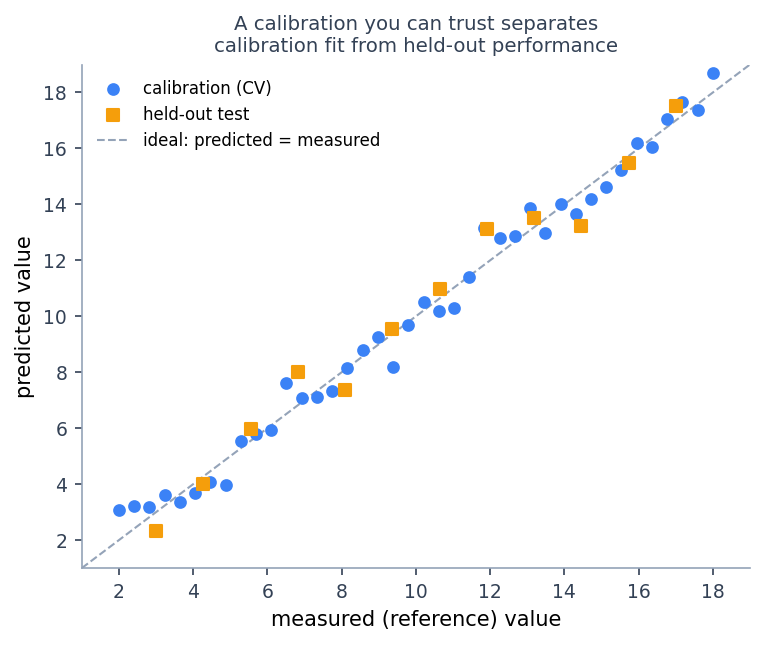

# PLS Calibration

!!! abstract "Summary"
    PLS regression: the default method for predicting a number (moisture, concentration) from spectra. Covers choosing latent variables, reading validation metrics, and avoiding overfitting.

Partial Least Squares regression models the relationship between spectra and quantitative targets. It is the default calibration method for spectroscopy because it tolerates strongly collinear spectral channels and small sample counts better than ordinary regression.

## Use PLS For

- concentration calibration
- property prediction
- multi-target regression
- comparing full-spectrum and selected-region models

## When PLS Is the Wrong Tool

- The relationship is strongly nonlinear and no preprocessing linearizes it: consider SVR or another nonlinear method, with extra validation care.
- You need class membership, not a number: use [classification](classification.md).
- Your reference values are imprecise relative to the variation you want to predict — no algorithm repairs a noisy target. PLS extracts the spectral components correlated with *your measured* target, including its errors.

## Choosing Settings

- **Number of components (latent variables)**: too few can underfit; too many can fit noise. Compare counts using cross-validation appropriate to the sampling design, keeping related specimens together when groups exist. A minimum-error or explicitly chosen simpler-model rule is a selection decision, not proof of performance on new samples. Do not select from training-fit error alone.
- **PLS1 vs PLS2**: PLS1 fits one response; PLS2 fits several jointly. Prefer PLS2 when responses share spectral structure and you want one model; expect slightly different coefficients than separate PLS1 fits. Multi-response results keep one complete metric set per named response — errors in different units are never blended.
- **Scaling**: the canonical node offers a `scale` option (autoscaling). For spectra, prefer explicit preprocessing (SNV, MSC, derivatives) and leave autoscaling off unless you have a reason; autoscaling amplifies noise-dominated channels.
- **Solver**: Sherpa's native PLS uses de Jong's SIMPLS algorithm for both PLS1 and PLS2, so Workbench, SDK, exports, and managed runs share one numerical authority.

## Outputs to Inspect

- predicted vs measured values
- RMSEP, SEP, bias, R2, and CV metrics
- CV predictions when available
- VIP scores
- regression coefficients by spectral variable
- X and Y scores/loadings

*Illustrative synthetic data. The plot to expect from a PLS calibration:
calibration (cross-validation) predictions in one color, held-out test
predictions in another, against the ideal line. An honest model shows similar
scatter in both; a much tighter calibration cloud is an overfitting warning.*

**VIP scores** rank variables by their contribution to the model; the common rule of thumb treats VIP > 1 as influential. Use VIP to prune or understand a model, not as a band assignment — a high-VIP region can be influential because it corrects an artifact, not because the analyte absorbs there.

**Regression coefficients** should be interpreted alongside preprocessing, correlated bands, and known interferents. Their signs are not direct band assignments. Unstable, high-frequency coefficients can indicate sensitivity to noise; compare them across defensible validation fits.

## Validation Caution

Calibration metrics are only meaningful when the target values are aligned to the correct spectra and validation respects sample structure. Replicates, time series, and batches can inflate random cross-validation if they leak across folds. See [Designing Validation](validation-design.md) before quoting any number, and [Validation and Model Application](validation-application.md) for how saved results are reported.

## Further reading

- S. de Jong, *SIMPLS: an alternative approach to partial least squares regression*, Chemometrics and Intelligent Laboratory Systems 18 (1993) 251–263 — the algorithm Sherpa's PLS implements.
- P. Geladi and B. R. Kowalski, *Partial least-squares regression: a tutorial*, Analytica Chimica Acta 185 (1986) 1–17.
- S. Wold, M. Sjöström, and L. Eriksson, *PLS-regression: a basic tool of chemometrics*, Chemometrics and Intelligent Laboratory Systems 58 (2001) 109–130.
- H. Martens and T. Næs, *Multivariate Calibration*, Wiley, 1989.
- I.-G. Chong and C.-H. Jun, *Performance of some variable selection methods when multicollinearity is present*, Chemometrics and Intelligent Laboratory Systems 78 (2005) 103–112 — source of the VIP &gt; 1 rule of thumb.
