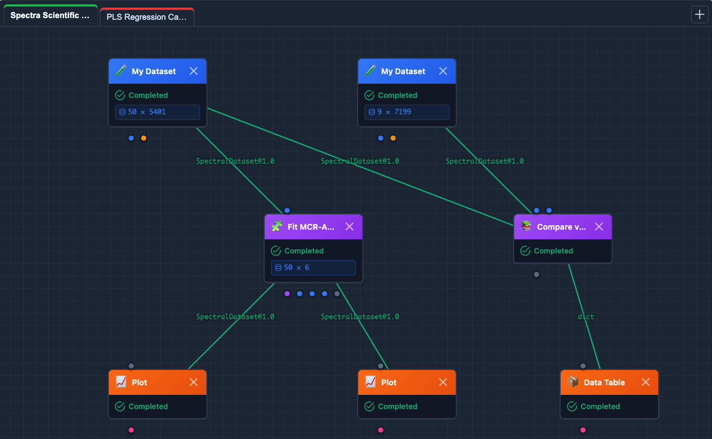

# SpectraSherpa OSS

!!! abstract "Summary"
    **New here?** Start with [Choose Your Path](onboarding/choose-your-path.md).
    For methods, use the [Chemometrics Guide](chemometrics/index.md); for a node's
    exact parameters and ports, the [Node Library](nodes/index.md).

SpectraSherpa is a local workbench and Python SDK for spectroscopy and
chemometrics. Import spectra or feature tables, inspect samples and axes,
build an analysis, compare results, and export a reproducible record.
Local scientific workflows need neither an account nor an AI provider.

These guides describe **SpectraSherpa v0.6.4**. Source version alone does not
establish availability; check [PyPI](https://pypi.org/project/spectra-sherpa/)
and follow [Local onboarding](onboarding/local-30-minutes.md) for the matching
installation route. Desktop packaging remains paused until separately authorized.

<figure class="ss-hero-figure">
  
</figure>

## Start with your task

| Task | Guide |
| --- | --- |
| Install the local application | [Local onboarding](onboarding/local-30-minutes.md) |
| Load spectra and reference values | [Import your first dataset](onboarding/import-first-dataset.md) |
| Find the starter, nodes and metrics for a task | [Chemometrics quick reference](chemometrics/quick-reference.md) |
| Explore structure and unusual samples | [PCA](chemometrics/pca.md) |
| Build and evaluate a calibration | [Your first calibration](onboarding/first-calibration.md) |
| Compare preprocessing or model settings | [Compare calibration workflows](workflows/optimize-saved-result.md) |
| Share results or continue in Python | [Reports and exports](workflows/reports-exports.md) |
| Work from a notebook or script | [Python workflows](onboarding/python-canonical-workflows.md) |

## What is included

The local workbench provides projects, datasets, visual workflows, saved runs,
model application, tables, plots, and reports. Scientific methods include
preprocessing, PCA, PLS, classification, variable selection, calibration
transfer, and peak/library comparison. EFA, MCR-ALS, and SIMPLISMA require the
optional SpectroChemPy runtime.

Use [Current capabilities](introduction/capabilities.md) and
[Supported file types](introduction/file-types.md) to check prerequisites.
Optional reference acquisition and AI chat require explicit configuration.
Managed Advisor and Optimize services are not included in OSS; see
[Product boundaries](introduction/cloud-vs-local.md).

## Interpret and document the result

Keep the evaluated population, units, preprocessing and validation design
with every reported metric. A successful run does not establish predictive
performance or laboratory qualification. See
[Validation and model application](chemometrics/validation-application.md).

Cite the methods and [upstream resources](attributions/index.md) used in your
analysis. Source contributors can use the [architecture](architecture/index.md)
and [developer guides](developers/contributing.md); those describe the checked-out
source and do not announce new released features.
