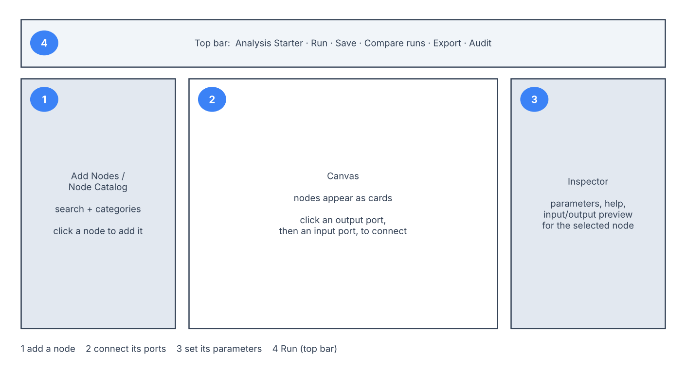

# Build a Workflow on the Canvas

!!! abstract "Summary"
    The Workflow tab is where analysis happens: you place processing and
    modeling steps ("nodes") on a canvas, connect them, and press **Run**.
    This page shows the layout and the exact clicks for the common tasks.
    Building and running workflows in Local OSS needs no account or
    subscription.

A workflow is a small directed graph: data enters through a source node
(usually **Collection Load**), flows through preprocessing and modeling nodes, and ends at output
nodes that produce plots, tables, and saved models. You never write code to
use it — but everything you build is inspectable, saved, and repeatable.

## The Builder at a Glance

*Schematic, not a screenshot: 1 add a node · 2 connect its ports · 3 set its
parameters · 4 Run.*

| Area | Where | What it is for |
| --- | --- | --- |
| **Add Nodes / Node Catalog** | left panel | Every available step, grouped by category, with search. |
| **Canvas** | center | Your workflow. Each node is a card showing its label, status, and ports. |
| **Inspector** | right panel | Parameters, help, and input/output preview for the selected node. |
| **Top bar** | top | **Analysis Starter**, **Run**, **Save**, **Compare runs**, **Export**, and (local app) **Audit**. Workflow warnings appear just below it. |

## Your First Workflow, Step by Step

1. **Open the Workflow tab** in the workspace.
2. **Click "Analysis Starter"** (top bar) and pick a template, or start blank.
   A template adds the right nodes in the right order and asks you to bind
   your data; it is the fast path. See [Templates](../workflow-templates/index.md).
3. **Add a node:** in the left **Add Nodes** panel, search or open a category,
   then **click the node's card**. It appears on the canvas. (Clicking, not
   dragging, is how nodes are added.)
4. **Connect two nodes:** input ports sit on a node's top edge and output
   ports on its bottom edge. **Drag an output port onto a compatible input
   port**, or click the output then the input. Hover shows each port's name
   and data type; keyboard users can focus ports and press Enter or Space.
   Press Escape to cancel a pending connection. Click a connection line to
   delete it. Drag a node's body to reposition it.
5. **Set parameters:** click a node to select it, then use the **Inspector**
   on the right. Every parameter has a default; the **?** next to the node
   name opens its help page. Missing-input warnings appear in Notifications;
   the connection in step 4 resolves them. To remove the node, click
   **Delete** in the Inspector, press <kbd>Delete</kbd>, or right-click it and
   choose **Delete Node**. An **Undo** banner appears right after a delete.
6. **Click Run.** Changes are saved automatically (the top bar shows
   **Unsaved changes**, then **Saved**); **Save** saves at once. The button
   reads **Run (Mod)** when the workflow has changed since its last run, so
   the results on screen no longer match it. When the run finishes, select a
   node to see its plots and tables in the Inspector.

A workflow never reads a file directly. A **Collection Load** node is bound to
a saved selection in **My Dataset**: bring data in first — see
[Data Import](data-import.md) — then select the node and choose that selection
in the Inspector's **Dataset** list. **Collection Load** is the only source node
offered in **Add Nodes**.

## Reading the Canvas While It Runs

- Each node card shows its state: **Pending**, **Running**, **Completed**,
  **Error**, or **Stale** (completed, but an upstream change means it must
  run again). An error is often a deliberate refusal, not a crash: select the
  node and read the reason in the Inspector — for example a missing required
  input or a dataset that does not meet the node's admission rule.
- **Workflow warnings** appear in a strip under the top bar and collect every
  admission or identity concern the run surfaced. Read them before trusting
  results; they are part of the result.
- Every run is kept on the **Runs** page. **Compare runs** (top bar) opens its
  history, where you pick saved runs to compare; comparing never re-runs the
  workflow.
- When auditing is turned on, **Audit** (top bar) opens the
  workflow's trail: what ran, with which parameters, and which data.

## Common Tasks

| I want to… | Do this |
| --- | --- |
| Start from a known-good recipe | **Analysis Starter** → pick a template → bind your dataset |
| Change which dataset a workflow uses | **Collection Load** source: select it and choose another saved selection in the Inspector's **Dataset** list. Other source nodes (File Load, Load Group, NIST Library) come from templates or imported workflows and have no dataset list: add a **Collection Load** node, choose the dataset, connect its outputs where the old source's were, then delete the old source. Or start again from **My Dataset** and open **Analysis Starter**, which binds the current selection |
| Compare two preprocessing choices | Right-click the sheet tab → **Duplicate**, change one node, run both sheets, then **Compare runs** — see [Compare Results](../chemometrics/comparison-and-promotion.md) |
| Reuse a workflow on another project | **Export** (top bar) gives a portable workflow file; import it there |
| Understand what a node does | Select it → Inspector help, or look it up in the [Node Library](../nodes/index.md) |
| Compare calibration settings fairly | [Compare calibration workflows](optimize-saved-result.md) — one sheet per alternative, same folds |

## Workflow-wide observation exclusions

In a workflow plot with exact source-row references, click observations or use
box/lasso selection, then **Exclude selected**. **Restore selected** restores
only the selected workflow exclusions; navigating to another node in the same
sheet does not change the scope. **Restore all** is a workflow action.
[The PCA walkthrough](../chemometrics/pca.md#exclusions-and-row-numbers) gives a
150 → 148 → 149 → 150 example.

Selection applies to individual observations, including sample plots produced
by visualization nodes. Choose **Box Select** or **Lasso Select** in the plot
toolbar before dragging; dragging with **Zoom** selected changes the axes.
Loadings, variable correlations and aggregate curves do not identify observations
and do not offer sample exclusion.

In workflow **View Data**, two small symbols precede each identified observation
in the existing matrix. Hover the first for membership in the displayed
calculation; hover the second for its current exclusion state. Click the second
to exclude or restore that observation. A point excluded after calculation was
still used in that result; rerunning updates the first symbol. Original sample
identities remain unchanged.

When the operation retains a qualified display cohort, workflow-excluded observations
remain inspectable in that same table, with dashes for unavailable computed
values. An unrelated source or another branch's observations are never added.
Rows already excluded in My Dataset stay outside the workflow population;
restore those in My Dataset first.
The preview reserves room for active observations when many rows are excluded;
CSV still exports the actual computed rows. Previous runs keep their recorded
decisions; current edits do not rewrite them.

The decision belongs to **Load Data**, not the plot or model. Collection Load,
File Load and Load Group materialize the active population before any branch:
spectra, responses, groups and sample metadata remain aligned. All connected
nodes receive that population. A downstream **Filter Samples** can further
restrict its own branch; restoring a workflow exclusion does not change it.
Restoration also does not undo exclusions already saved in My Dataset.
Those saved exclusions define the workflow's starting population: they remain
inspectable in My Dataset and Load Data, but do not appear as downstream model
overlays. Only workflow exclusions can be restored from a workflow plot.
Each source owns its own exact ordered references, even if two sources have
the same editable labels. Changing the source invalidates its old decisions
instead of applying them to a different set of observations.

The **Exclusion State** output records every source row, its original label,
typed sample ID when present, source inclusion, workflow exclusion and current
result row. It is a membership table, not an alternate spectral input. My
Dataset stays unchanged. Save/reopen preserves the sheet's decisions and each
retained run preserves its own original population.

For a portable sample-table source, its table port follows the same retained
rows as its data and response ports. Original zero-based source indices are
preserved, including gaps; they are not new result-row numbers. Attaching the
table preserves the source references used for later selection and restoration.

Editable workflow files preserve these source-bound settings. Python/notebook
exports (including executable bundles) currently refuse a nonempty workflow
exclusion: their portable deployment-input substitution cannot yet replay the
Workbench source binding. They do not silently export an uncurated fit.
Active-result CSV/JSON downloads remain available.
Optimize currently refuses active workflow exclusions with an explicit reason;
**Restore all** removes the override and makes the workflow eligible again.

### Excluded observations on plots

Numerical ports, data tables, CSV exports and fit/evaluation metrics contain
the active result. Display-only companions may additionally show excluded
observations with open-cross symbols (spectral lines are dotted). They cannot
be connected to computational nodes or counted as fit/validation rows.
Numeric color scales and their hover values are preserved; the cross, rather
than a replacement color, identifies excluded points on those plots.

| Operation | Excluded-observation display |
| --- | --- |
| Load Data | Source values, with exact membership and source references |
| Branch Filter | Only observations matching the branch predicate; result-row index filters have no inferred excluded-row position |
| Declared row-local preprocessing (normalization, smoothing, derivatives, clipping and supported baseline corrections) | The same per-spectrum transformation, without a cohort refit |
| Scale/Center, MSC, EMSC and OSC | Application of the exact retained active-population transform state |
| PCA scores and T²/Q diagnostics | Application to the current PCA fit; diagnostic limits and fitted population stay unchanged |
| Loadings, aggregate summaries and component-selection curves | Fit-level results; no per-observation position to overlay |
| Other operations without a declared application, including unassigned split branches | Active results only; an unavailable overlay is identified rather than guessed |

Display limits still apply; the visible **Subset** indicator is separate from
an exclusion decision. Excluded observations are prioritized within those
limits, not guaranteed to bypass them. Plot-driven curation supports up to
100,000 observations in a two-dimensional sample-feature source. N-D sources
retain their shape and axis masks for explicit projection; plot-driven source
curation is unavailable, rather than guessing how to flatten them. Larger
two-dimensional datasets still load with their saved source
inclusion applied, without plot-driven workflow curation. An excluded
projection exceeding the 64 MiB input budget is unavailable, without changing
the computational result. Optional projections run in an isolated worker with
a 60-second limit. SDK callers that disable workers retain active results but
do not receive an excluded-row overlay. Bounded spectral previews reserve room
for active spectra; excluded curves cannot crowd them out.

Sherpa Advisor and existing Guidance receive workflow exclusion counts and
scope through their normal permission-controlled context. Those counts are
settings, not proof that a rerun succeeded, and do not confer independent
validation. Neither system receives private navigation references through the
summary context or changes exclusions automatically.
Guidance idle summaries may be up to 15 seconds old; action and navigation
events refresh them. They are suggestions, not execution or admission authority.

## When Something Refuses to Run

Refusals are deliberate and explain themselves: a node that needs a target
column says so; a split that would mix replicates of one specimen across
calibration and test refuses and tells you to declare specimen identity.
Fix the cause — bind the missing input or declare the field — rather than
working around it. The refusal is the tool protecting your conclusion; see
[Designing Validation](../chemometrics/validation-design.md).

## Related Pages

- [Data Import](data-import.md) — getting files into My Dataset
- [Templates](../workflow-templates/index.md) — the starter recipes
- [Node Library](../nodes/index.md) — every node, its ports, and its parameters
- [Reports and Exports](reports-exports.md) — turning a run into a document
