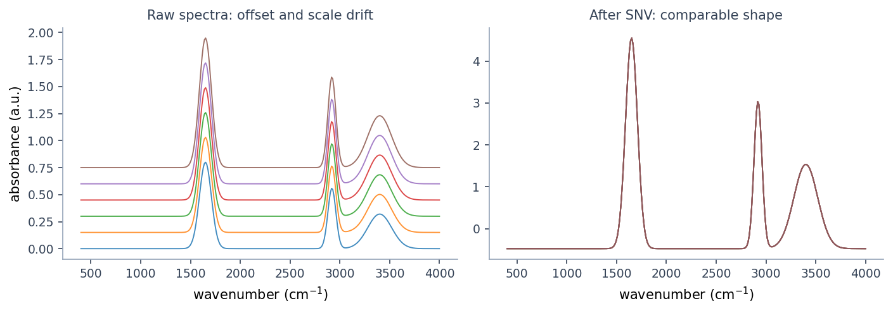

# Preprocessing Spectra

!!! abstract "Summary"
    The common preprocessing steps (scatter correction, derivatives,
    smoothing, centering, region selection), a practical order to apply them,
    and when each one helps or hurts.

Preprocessing should make spectral variation easier to model without hiding scientific problems.

## Common Steps

- smoothing for noisy spectra
- derivatives for baseline and shape emphasis
- baseline correction
- normalization or scaling
- mean centering or autoscaling before multivariate models
- spectral region selection

*Illustrative synthetic data. Left: raw spectra with offset and scale drift —
the same chemistry at different baselines. Right: after Standard Normal Variate
(SNV), each spectrum is centered and scaled to itself, so shape becomes
comparable. Preprocessing like this helps when the drift is physical (scatter,
path length), not chemical.*

## Practical Order

A common FTIR/Raman starting point is:

1. inspect raw spectra
2. correct obvious baseline effects
3. smooth only if noise affects downstream metrics
4. normalize or scale based on the analytical question
5. run PCA before calibration

## Leakage Awareness

Some preprocessing choices are harmless for exploration but risky for validation if fitted using all samples. When validating calibration performance, prefer split-aware workflows and treat metrics as optimistic when preprocessing was fit on the full matrix before cross-validation.
